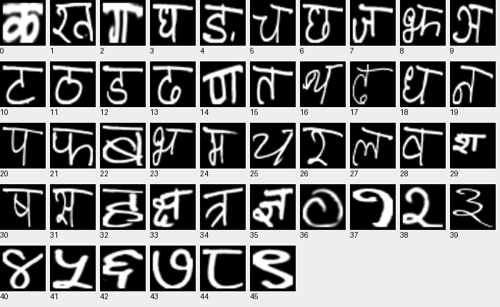

Devanagari Handwritten Character Dataset
============================================

Overview
--------

Devanagari Handwritten Character Dataset is a grayscale image classification dataset with
46 classes and 32 x 32 images. The official split is preserved:

- **Train**: 78,200 images.
- **Test**: 13,800 images.

Data Structure
--------------

Each sample contains ``image`` (a grayscale ``PIL.Image.Image``) and
``label`` (an integer class ID).

Labels 0-35 follow the numeric archive folders ``character_1_ka`` through
``character_36_gya``. Labels 36-45 correspond to ``digit_0`` through
``digit_9``. The original folder names are available in
``ds.features["label"].names``. This mapping uses numeric character order,
not lexicographic folder order.

The original two-pixel padding is retained. Both splits use the same ZIP
archive, which is downloaded once. Images are stored as their original PNG
bytes; neither resizing nor RGB conversion is applied.

Usage
-----

.. code-block:: python

    from stable_datasets.images import Devanagari

    ds = Devanagari(split="train")
    sample = ds[0]
    print(sample["image"].size, sample["label"])

    # Load both official splits.
    splits = Devanagari()
    print(len(splits["train"]), len(splits["test"]))

    # Images become float tensors of shape (1, 32, 32).
    tensor_ds = ds.with_format("torch")

Downloads are verified with SHA-256 checksums. Set ``download_dir`` and
``processed_cache_dir`` to choose local storage locations. Subsequent loads
reuse the processed cache. See the dataset source for its citation.

SimCLR validation: two independent one-epoch runs
-------------------------------------------------

Two epochs of training were completed in total per dataset, as two separate
one-epoch experiments initialized from scratch, not a continuous two-epoch run.
Both used ViT-Tiny/16 without pretrained weights, seed 42, batch size 64,
FP32, Apple M4/MPS, Python 3.13, and PyTorch 2.14.1. Evaluation used the
entire official test split.

.. list-table:: Online probe results (top-1 accuracy)
   :header-rows: 1

   * - Augmentation policy
     - Linear probe
     - k-NN probe
     - Wall time
   * - Original shared transforms
     - 8.91%
     - 19.33%
     - 44m 33s
   * - Handwriting-specific transforms
     - 17.33%
     - 26.09%
     - 20m 10s

The first experiment used the shared SimCLR random transformations: random
resized crops to 224 x 224 (scale 0.08-1.0), horizontal flips (p=0.5), and
Gaussian blur (kernel 23, sigma 0.1-2.0, p=0.5). Color jitter and random
grayscale were skipped because the source images are grayscale.

The second experiment used a policy designed to retain the full character
and its orientation: resize to 224 x 224, then random scaling (0.85-0.95)
and translation (up to 2% in each axis), with bilinear interpolation and
black fill. No rotation, flips, cropping, or blur are applied. Both policies
create two independently sampled views, convert to RGB, and normalize using
statistics from the training split. Evaluation remains deterministic: RGB
conversion, resizing, and normalization.

Both probe scores improved with the revised policy in this single-seed
comparison, consistent with preserving character identity. This does not
isolate which transform caused the improvement or establish converged
performance. No additional training epoch was accumulated between runs.

The linear probe trains on detached embeddings alongside the backbone; this
is not a separately fitted post-training linear evaluation. The online k-NN
probe uses k=10 and a queue of 20,000 training embeddings. Labels train the
probes, not the contrastive objective. The official test split is supplied
to the runner's validation loader, with no separate tuning split; these
exploratory comparisons should not be treated as an untouched final test.

The command below reproduces the current handwriting-specific policy.

Run from the repository root, with benchmark dependencies installed:

.. code-block:: bash

    python -m benchmarks.run model=simclr dataset=devanagari \
      backbone=vit_tiny_patch16_224 data_dir=/path/to/data \
      smoke_test=false seed=42 training.max_epochs=1 \
      training.batch_size=64 training.num_workers=0 \
      training.precision=32-true wandb.enabled=false \
      checkpoint.dir=/path/to/new-run/checkpoints

The run used ``stable-pretraining`` commit
``ab836bf699a2be712dfcf980a5eb70d36391e876`` and its ``forward.simclr`` API.
Use a fresh output/checkpoint directory for reproduction: the benchmark
runner automatically resumes an existing matching ``last.ckpt``.

References
----------

- Source: https://archive.ics.uci.edu/dataset/389/devanagari+handwritten+character+dataset
- License: Creative Commons Attribution 4.0 International (CC BY 4.0).
- Citation: Acharya, S. and Gyawali, P. (2015). Devanagari Handwritten
  Character Dataset. UCI Machine Learning Repository. https://doi.org/10.24432/C5XS53.
